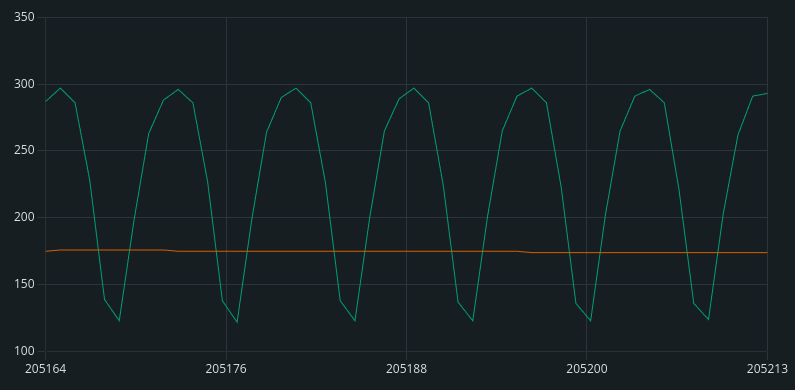
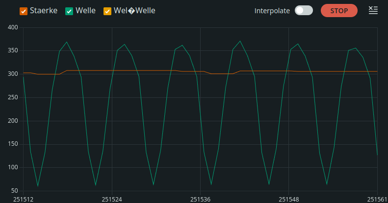
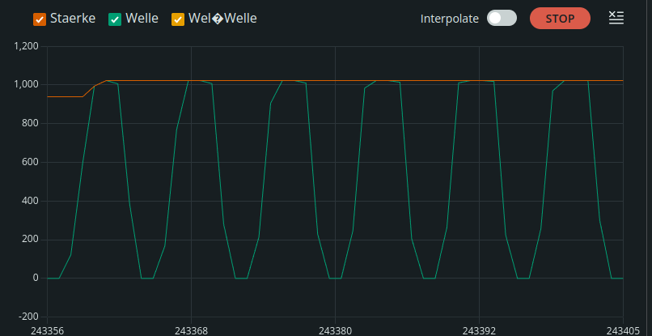

# 8. Dezember: Die Luft ist voller Strom

**Heute neu:** nichts, nur eine **kurze Steckbrücke** (10 bis 20 cm)

Heute baust du deine erste Antenne. Sie besteht aus genau einer Steckbrücke.

## Aufbau

Eine kurze Steckbrücke mit einem Ende in die Buchse **A0** am Uno stecken. Das andere Ende liegt frei auf dem
Tisch. Sonst nichts. Alles andere auf dem Steckbrett darf stecken bleiben.

**Wirklich kurz!** Ein langer Draht fängt so viel ein, dass der Arduino schon in Ruhe am Anschlag ist und du
keinen Unterschied mehr siehst.

## Programm

[`tag08_offener_eingang.ino`](../sketches/tag08_offener_eingang/tag08_offener_eingang.ino), dann
**Werkzeuge → Serieller Plotter** öffnen (115200 Baud).

## Was passiert

Für den Plotter bleibt der Uno heute am PC. Im Plotter siehst du zwei Linien:

- **Welle**: was deine Antenne gerade auffängt. Schon in Ruhe läuft eine kleine, gleichmäßige Welle durch.
- **Staerke**: wie groß die Welle ist. Darauf achtest du heute. In Ruhe liegt sie ungefähr bei 150 bis 200.

So sieht es in Ruhe aus: Die Welle schwingt gleichmäßig, die Staerke-Linie liegt flach bei etwa 175.

Jetzt die Hände ins Spiel bringen, **ohne die Steckbrücke zu berühren**:

1. Finger von oben an die Spitze: Es tut sich nur wenig.
2. Finger von der Seite an die Steckbrücke heranführen: Staerke steigt auf 200, 250 …
3. Seitlich die Isolierung berühren: um 350.
4. Ganz zart die blanke Spitze antippen: Staerke springt auf 700 und mehr. Fester drücken: noch höher.

Finger seitlich an der Isolierung: Die Welle wird größer, Staerke steigt auf rund 300.

Spitze fest angefasst: Die Welle schlägt von 0 bis 1023 aus und wird oben und unten platt abgeschnitten. Mehr kann
der Arduino nicht messen, er ist am Anschlag.

Siehst du im Plotter eine dritte, merkwürdig benannte Linie (zum Beispiel „Wel�Welle“)? Die entsteht, wenn der
Plotter mitten in einer Zeile zu lesen beginnt. Einfach das Häkchen davor wegklicken.

Du siehst also, wie nah du bist, ohne etwas anzufassen. Dein Körper fängt den Strom aus den Kabeln im Raum ein
und gibt ihn an die Antenne weiter.

## Probier mal

- Zähl die Berge der Welle: Acht Punkte ergeben einen Berg, das sind 50 Berge pro Sekunde.
- Leg ein eingestecktes Lampen- oder Verlängerungskabel direkt neben die Steckbrücke und nimm es wieder weg.
  Ändert sich Staerke? **(prüfen)**
- Steck zum Vergleich einen langen Draht (1 m) an: Staerke geht schon in Ruhe fast bis zum Anschlag. Mehr Antenne
  heißt mehr Empfang, aber irgendwann zu viel.

## Übrigens

Durch jedes Kabel im Haus fließt Wechselstrom, der 50-mal pro Sekunde die Richtung wechselt. Um das Kabel herum
entsteht ein elektrisches Feld, das genauso schwingt. Dein Draht fängt einen winzigen Teil davon auf. Genau das
macht jede Antenne: Sie fängt Schwingungen aus der Luft ein. Bei Radio und Handy sind es nur viel, viel schnellere.
